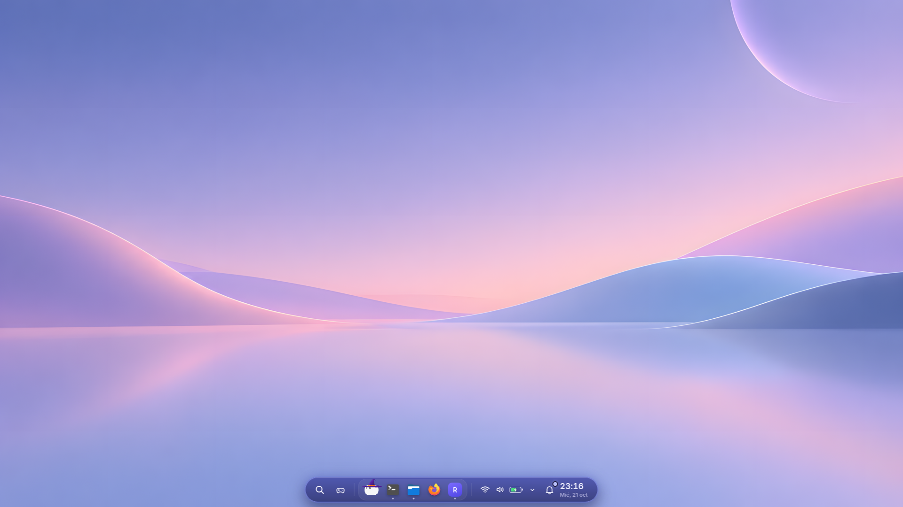
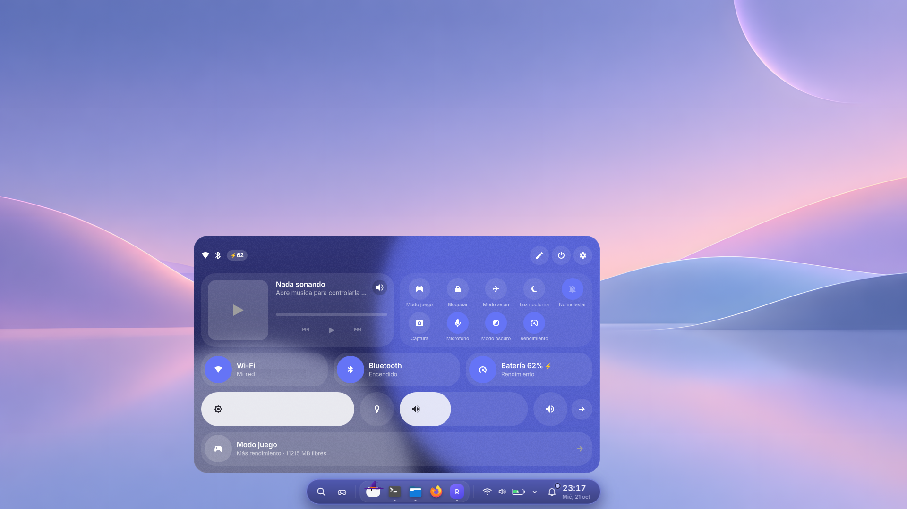
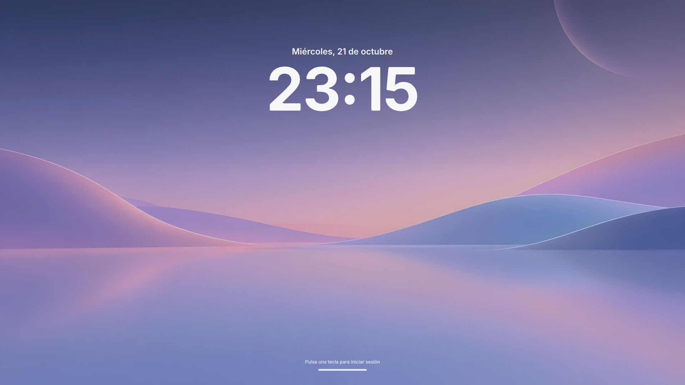
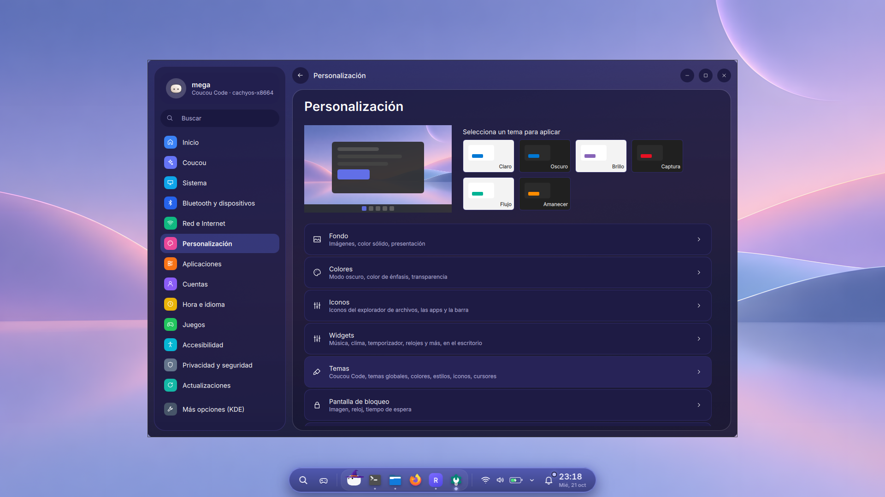
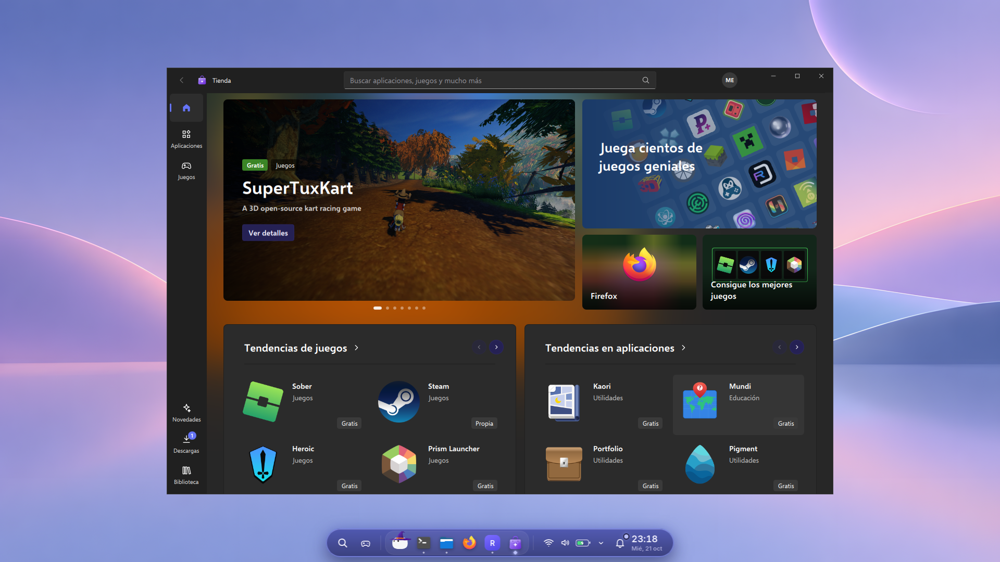
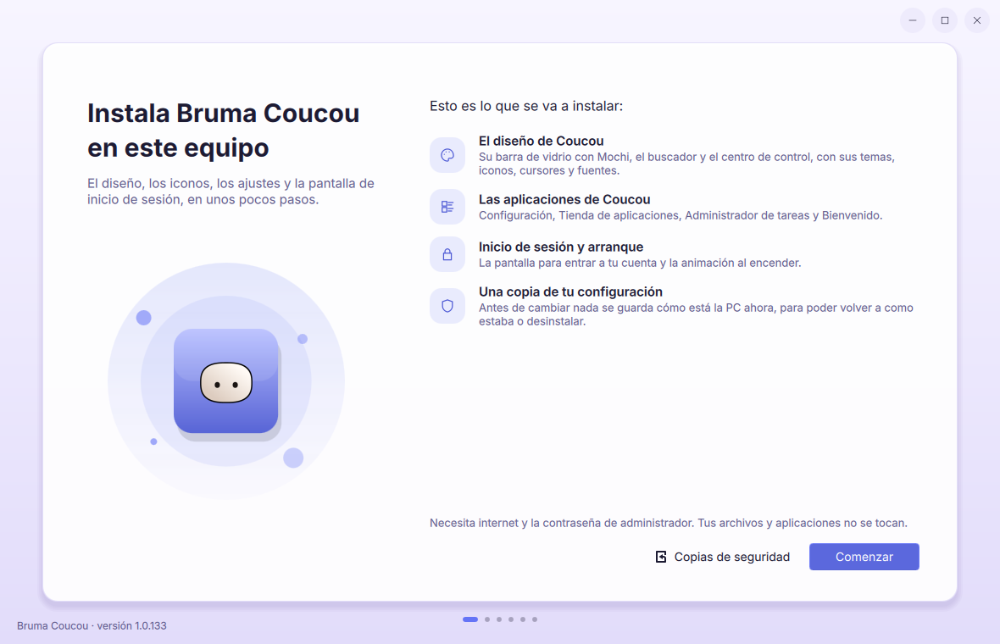
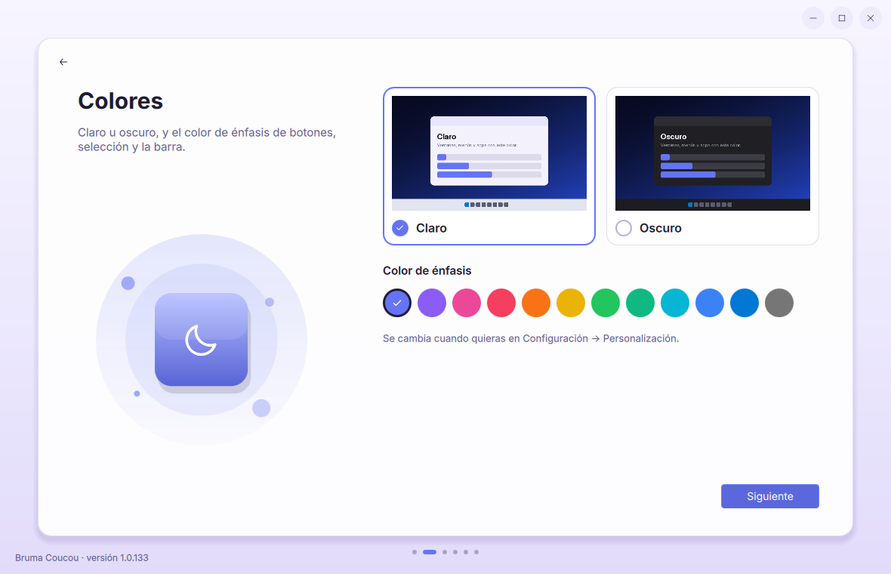
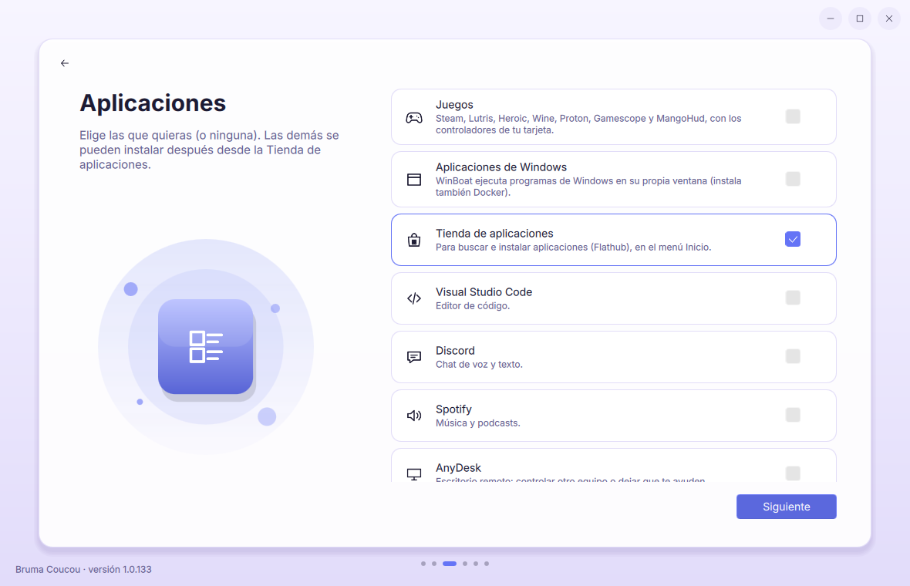
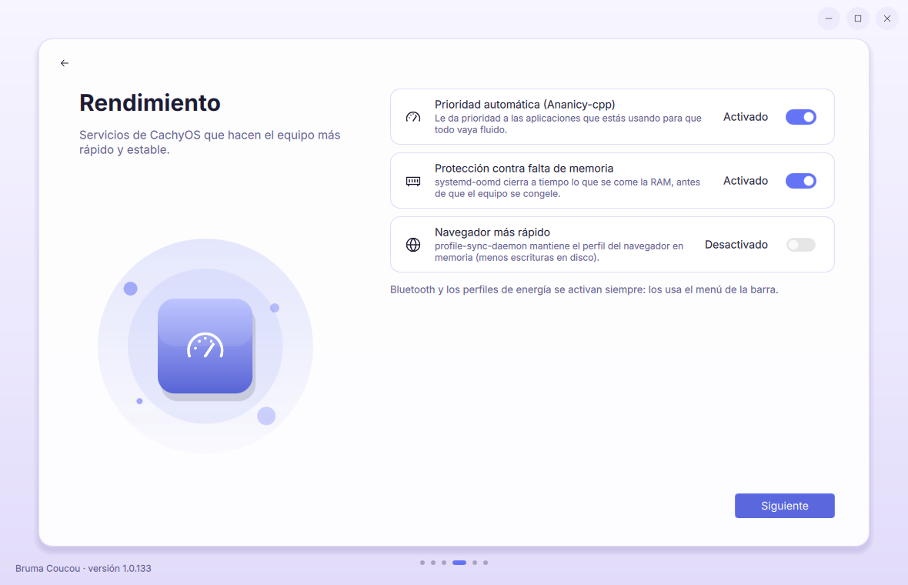
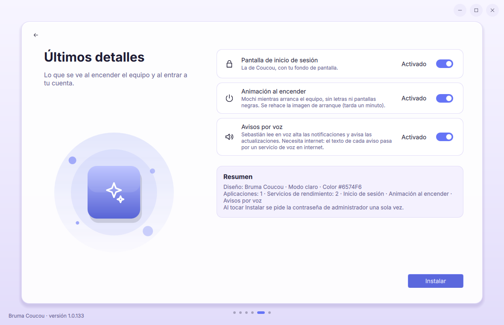

# Bruma Coucou

**Bruma Coucou** es un instalador que transforma un **CachyOS con KDE Plasma 6** en Bruma, un
escritorio con integración de [Coucou](https://github.com/Louis-CFM/coucou): suave, en tonos lavanda
y rosa, con una barra de vidrio flotante.
Se instala con unos pocos clics desde una ventana y se puede desinstalar en cualquier momento:
la PC vuelve a quedar como estaba.



## Qué instala

| | |
|---|---|
| **La barra con Mochi** | Barra de vidrio flotante con buscador, apps, Wi-Fi, sonido, batería, notificaciones y reloj. |
| **Centro de control** | Panel flotante (Meta+C) con música, Wi-Fi, Bluetooth, brillo, volumen, energía y modo juego. Se puede reordenar y cambiar de tamaño. |
| **Temas** | Modo claro u oscuro, color de énfasis a elección, iconos (Papirus con carpetas violetas), cursores y la fuente Inter. |
| **Fondo de pantalla** | El paisaje de bruma lavanda, el mismo en todas las pantallas. |
| **Inicio de sesión** | Una pantalla de login (SDDM) con **el mismo fondo que el escritorio**, reloj grande y Mochi. |
| **Animación al encender** | Mochi mientras arranca el equipo, sin letras ni pantallas negras (Plymouth). |
| **Apps de Coucou** | Configuración, Tienda de aplicaciones (Flathub + repositorios + AUR), Administrador de tareas y Bienvenido. |
| **Widgets** | Música, clima, rendimiento, relojes, temporizador y más, para el escritorio. |
| **Extras opcionales** | Juegos (Steam, Lutris, Heroic…), VS Code, Discord, Spotify, AnyDesk, VLC, avisos por voz y servicios de rendimiento de CachyOS. |

## Capturas

### Centro de control


### Inicio de sesión
El login usa el mismo fondo que el escritorio.



### Configuración y Tienda
| Configuración | Tienda de aplicaciones |
|---|---|
|  |  |

### El instalador
| | |
|---|---|
|  |  |
|  |  |
|  | |

## Requisitos

- **CachyOS** (o Arch Linux) con **KDE Plasma 6** en Wayland.
- Conexión a internet (las dependencias se bajan de los repositorios).
- La contraseña de administrador (se pide una sola vez).

## Cómo instalar

1. Descarga el proyecto (botón **Code → Download ZIP**, o el zip de la sección **Releases**) y
   descomprímelo. También puedes clonarlo:
   ```bash
   git clone https://github.com/LoboViejo79/bruma-coucou-kde-linux-installer.git
   cd bruma-coucou-kde-linux-installer
   ```
2. Haz doble clic en **"Instalar Bruma Coucou"** (o en una terminal: `./instalar.sh`).
3. Elige claro u oscuro, el color, las apps y los detalles, y toca **Instalar**.
4. Al terminar, **reinicia el equipo**: el inicio de sesión y la animación al encender se ven
   después de reiniciar.

Desde la terminal, sin ventana:

```bash
./instalar.sh --diseno coucou                              # instalar
./instalar.sh --diseno coucou --modo oscuro --sin-arranque # oscuro y sin animación al encender
./instalar.sh --actualizar                                 # poner solo lo nuevo
./instalar.sh --reinstalar --diseno coucou                 # reinstalación limpia
```

## Actualizar

Si ya está instalado, el instalador dice qué versión tienes y el botón **Actualizar** pone solo lo
nuevo. Tu diseño, fondo, colores, apps e inicio de sesión quedan como estaban.

## Copias de seguridad y desinstalar

- La **primera vez**, antes de cambiar nada, se guarda cómo estaba la PC
  (`/var/lib/coucou-instalador/original`). Esa copia nunca se borra.
- **Cada instalación o actualización** guarda una copia de tus ajustes
  (`~/.local/share/coucou-instalador/respaldo-<fecha>`, quedan las 10 más nuevas).
- Para volver a como estaba todo: doble clic en **"Desinstalar Bruma Coucou"** (o
  `./desinstalar.sh`).

```bash
./desinstalar.sh --ver        # historial y copias
./desinstalar.sh --simular    # muestra qué haría, sin cambiar nada
./desinstalar.sh --con-apps   # también quita las apps que se instalaron
```

Tus archivos personales no se tocan nunca.

## Qué hay en el proyecto

```
Bruma Coucou/
├── Instalar Bruma Coucou.desktop     doble clic para instalar
├── Desinstalar Bruma Coucou.desktop  doble clic para desinstalar
├── instalar.sh                       abre la ventana o instala desde la terminal
├── paso-sistema.sh                   parte de administrador: paquetes, login, arranque
├── paso-cuenta.sh                    parte de tu cuenta: diseño, barra, fondo
├── desinstalar.sh                    deja la PC como estaba antes
├── copia.sh · estado.sh · apps-instaladas.sh
├── bin/                              la ventana del instalador
├── imagenes/                         imágenes de la ventana
├── paquetes/                         los paquetes que se instalan
├── perfil/                           ajustes de la barra y el fondo de pantalla
├── capturas/                         las capturas de este README
└── fuente/                           el código para modificar y volver a armar todo
```

## Modificar y volver a armar

Todo el código de los paquetes está en `fuente/`. Después de cambiar algo:

```bash
fuente/construir.sh --revisar   # dice qué cambió
fuente/construir.sh             # vuelve a armar los paquetes y sube la versión
fuente/construir.sh --zip       # además arma ../bruma-coucou-vX.Y.Z.zip para compartir
```

La explicación completa de cómo está armado (dónde está cada cosa, widgets, centro de control,
transiciones de la barra) está en [`fuente/LEEME.md`](fuente/LEEME.md).

## Créditos y autoría

> **Coucou y Mochi no son obra de este proyecto.** La barra de Coucou, Mochi y sus imágenes
> pertenecen a sus autores ([Coucou](https://github.com/Louis-CFM/coucou)). Bruma Coucou solo los
> integra en el escritorio; todos sus derechos siguen siendo de ellos.

- La barra y Mochi vienen de [Coucou](https://github.com/Louis-CFM/coucou) (licencia MIT; sus
  imágenes tienen su propia licencia).
- La base del tema (iconos, cursores y las apps `win11-*`) viene del tema Windows 11 para KDE.
- Iconos [Papirus](https://github.com/PapirusDevelopmentTeam/papirus-icon-theme) y fuente
  [Inter](https://rsms.me/inter/).
